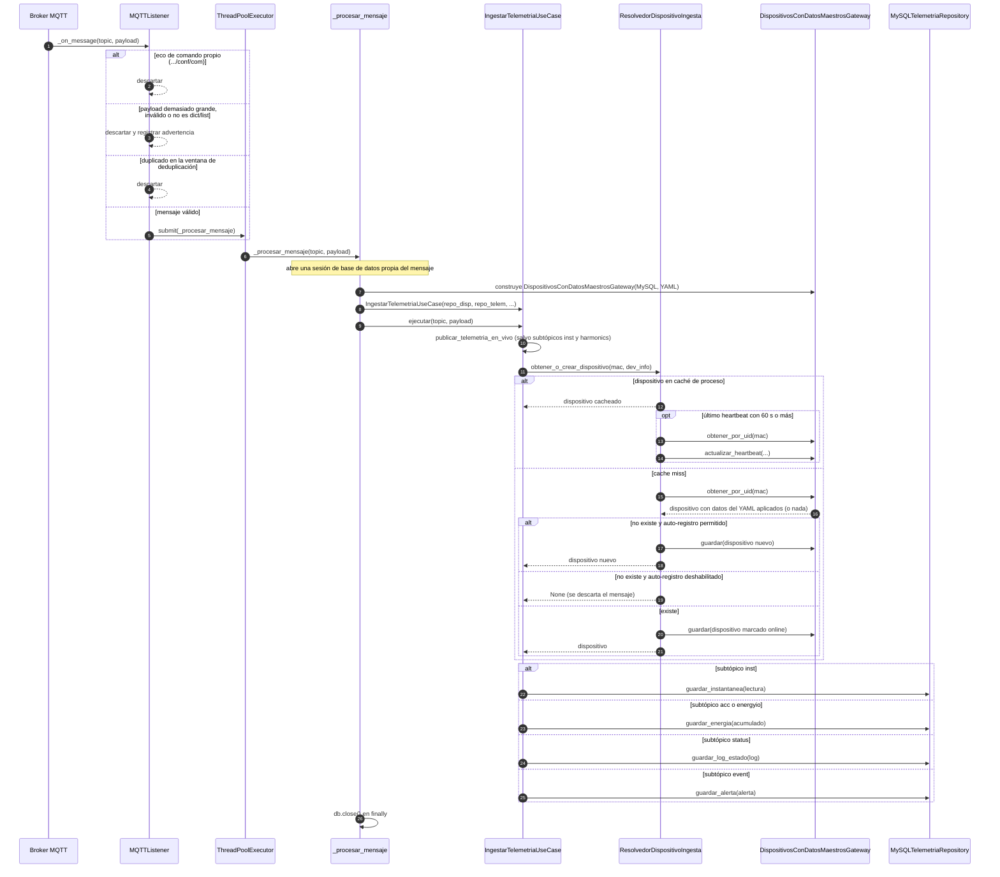

# Puertos, adaptadores y flujo de ingesta MQTT

Este documento complementa `database_erd.md`, que muestra tablas y claves foráneas. Acá se muestran dos cosas que el ERD no cubre:

1. **Diagrama de clases:** cómo se relacionan un puerto del dominio y sus implementaciones, incluido el decorador que aplica la precedencia del YAML.
2. **Diagrama de secuencia:** el camino que recorre un mensaje MQTT desde que llega al broker hasta que se persiste.

Ambos diagramas están en Mermaid, así que se renderizan en GitHub y se mantienen junto al código.

---

## 1. Puerto de dispositivos y sus implementaciones

`RepositorioDispositivosPort` es el contrato que usa el dominio. Hay dos implementaciones concretas: una que lee de MySQL y otra que decora a la primera aplicando los datos maestros del YAML.

```mermaid
classDiagram
    direction LR

    class RepositorioDispositivosPort {
        <<abstract>>
        +obtener_por_id(dispositivo_id) Dispositivo
        +obtener_por_uid(uid) Dispositivo
        +listar(planta_id, organizacion_id) list
        +guardar(dispositivo) Dispositivo
        +actualizar_heartbeat(...)
    }

    class RepositorioOrganizacionesPort {
        <<abstract>>
        +obtener_instalacion_medidor(dispositivo_id)
        +obtener_nodos_unifilar(planta_id) list
    }

    class MySQLDispositivosRepository {
        +obtener_por_id(dispositivo_id)
        +guardar(dispositivo)
    }

    class YamlOrganizacionesRepository {
        +obtener_instalacion_medidor(dispositivo_id)
        +obtener_nodos_unifilar(planta_id)
    }

    class DispositivosConDatosMaestrosGateway {
        -_base: RepositorioDispositivosPort
        -_org: RepositorioOrganizacionesPort
        +obtener_por_id(dispositivo_id)
        +guardar(dispositivo)
    }

    class DatosMaestrosMedidorService {
        <<service>>
        +aplicar_instalacion(dispositivo, instalacion)$
        +aplicar_contrato(dispositivo, nodos)$
    }

    class IngestarTelemetriaUseCase {
        -repo_dispositivos: RepositorioDispositivosPort
    }

    RepositorioDispositivosPort <|.. MySQLDispositivosRepository : implementa
    RepositorioDispositivosPort <|.. DispositivosConDatosMaestrosGateway : implementa
    RepositorioOrganizacionesPort <|.. YamlOrganizacionesRepository : implementa
    DispositivosConDatosMaestrosGateway o-- RepositorioDispositivosPort : envuelve _base
    DispositivosConDatosMaestrosGateway o-- RepositorioOrganizacionesPort : consulta _org
    DispositivosConDatosMaestrosGateway ..> DatosMaestrosMedidorService : usa
    IngestarTelemetriaUseCase ..> RepositorioDispositivosPort : depende de
```

### Cómo leerlo

- La flecha con triángulo (`<|..`) es **implementación**: la clase concreta cumple el contrato del puerto.
- El rombo (`o--`) es **composición o agregación**: el decorador guarda una referencia a otro repositorio que cumple el mismo contrato.
- `IngestarTelemetriaUseCase` solo conoce el puerto. No sabe si detrás hay MySQL, el decorador o un doble de test. Eso es lo que permite inyectar el decorador sin tocar el caso de uso.
- El decorador implementa **la misma interfaz** que envuelve. Por eso el resto del sistema no distingue entre el repositorio crudo y el resuelto.

---

## 2. Flujo de un mensaje MQTT

Este diagrama sigue un mensaje de telemetría desde el broker hasta la persistencia. Se simplifican los nombres de los métodos internos de `_procesar_mensaje` y de los repositorios de telemetría.

### Cómo leerlo

- **Hilo del broker vs. pool de trabajo.** `_on_message` corre en el hilo de Paho y solo valida y encola. El trabajo pesado corre en `ThreadPoolExecutor`, así que el broker no se bloquea mientras se escribe en la base.
- **Sesión por mensaje.** Cada mensaje abre y cierra su propia sesión de base de datos. Así un error en un mensaje no contamina a los demás.
- **El decorador aparece en el flujo.** `_procesar_mensaje` construye `DispositivosConDatosMaestrosGateway` antes de crear el caso de uso. Por eso todo mensaje ve los datos del YAML aplicados, sin que el caso de uso lo sepa.
- **La caché de dispositivos es de proceso.** Por eso `ResolvedorDispositivoIngesta` no consulta la base en cada mensaje. Ver el reset de estado en `IngestarTelemetriaUseCase.limpiar_estado()`.
- **El ruteo por subtópico es un `if/elif`.** Si se agrega un subtópico nuevo, hay que tocar `ejecutar`. Es una decisión sencilla de leer, pero no es extensible sin modificar la clase.

---

## Qué mirar después

- Si cambia la firma de `RepositorioDispositivosPort`, hay que actualizar los dos diagramas.
- Los diagramas describen el camino feliz y las ramas principales. No muestran todas las excepciones.
