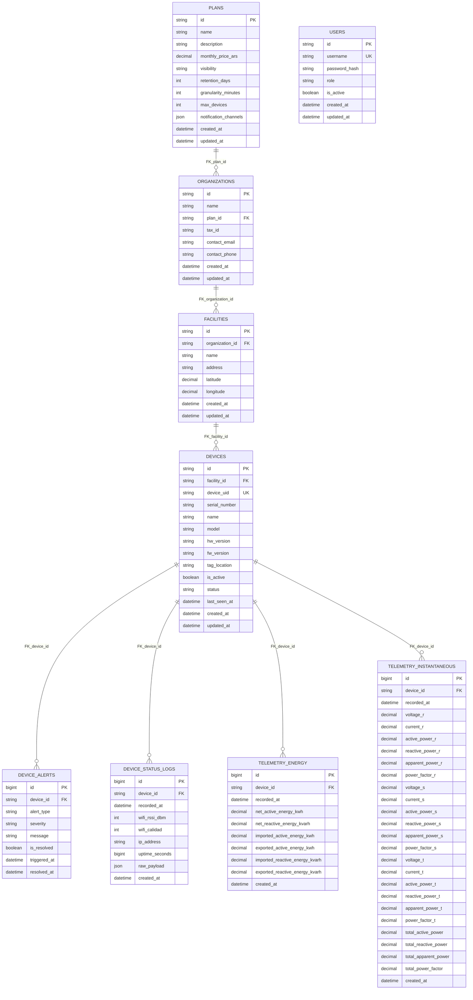

# Diagrama Entidad-Relación (ERD) — Datamaq Telemetry

> [!NOTE]
> Este documento se genera de forma 100% automática a partir de los modelos de SQLAlchemy
> (`src/infrastructure/sqlalchemy/models.py`) mediante el script `scripts/generate_erd.py`.

## 1. Diagrama de Relaciones

## 2. Detalle de Tablas e Índices

### Tabla `device_alerts`

| Columna | Tipo SQL | Clave / Restricción | Nullable |
| :--- | :--- | :--- | :--- |
| `id` | `BIGINT` | **PRIMARY KEY** | No |
| `device_id` | `VARCHAR(36)` | FK -> `devices.id` | No |
| `alert_type` | `VARCHAR(50)` | - | No |
| `severity` | `VARCHAR(8)` | - | No |
| `message` | `TEXT` | - | No |
| `is_resolved` | `BOOLEAN` | - | No |
| `triggered_at` | `DATETIME` | - | No |
| `resolved_at` | `DATETIME` | - | Sí |

**Índices:**
- `idx_alerts_dev_resolved`: (`device_id`, `is_resolved`)
- `idx_alerts_resolved_purge`: (`is_resolved`, `resolved_at`)
- `ix_device_alerts_device_id`: (`device_id`)

### Tabla `device_status_logs`

| Columna | Tipo SQL | Clave / Restricción | Nullable |
| :--- | :--- | :--- | :--- |
| `id` | `BIGINT` | **PRIMARY KEY** | No |
| `device_id` | `VARCHAR(36)` | FK -> `devices.id` | No |
| `recorded_at` | `DATETIME` | - | No |
| `wifi_rssi_dbm` | `INTEGER` | - | Sí |
| `wifi_calidad` | `INTEGER` | - | Sí |
| `ip_address` | `VARCHAR(45)` | - | Sí |
| `uptime_seconds` | `BIGINT` | - | Sí |
| `raw_payload` | `JSON` | - | Sí |
| `created_at` | `DATETIME` | - | No |

**Índices:**
- `idx_device_status_dev_time`: (`device_id`, `recorded_at`)
- `idx_device_status_time`: (`recorded_at`)

### Tabla `devices`

| Columna | Tipo SQL | Clave / Restricción | Nullable |
| :--- | :--- | :--- | :--- |
| `id` | `VARCHAR(36)` | **PRIMARY KEY** | No |
| `facility_id` | `VARCHAR(36)` | FK -> `facilities.id` | Sí |
| `device_uid` | `VARCHAR(64)` | UNIQUE | No |
| `serial_number` | `VARCHAR(64)` | - | Sí |
| `name` | `VARCHAR(100)` | - | No |
| `model` | `VARCHAR(50)` | - | No |
| `hw_version` | `VARCHAR(50)` | - | Sí |
| `fw_version` | `VARCHAR(50)` | - | Sí |
| `tag_location` | `VARCHAR(100)` | - | Sí |
| `is_active` | `BOOLEAN` | - | No |
| `status` | `VARCHAR(20)` | - | No |
| `last_seen_at` | `DATETIME` | - | Sí |
| `created_at` | `DATETIME` | - | No |
| `updated_at` | `DATETIME` | - | No |

**Índices:**
- `ix_devices_device_uid` (UNIQUE): (`device_uid`)

### Tabla `facilities`

| Columna | Tipo SQL | Clave / Restricción | Nullable |
| :--- | :--- | :--- | :--- |
| `id` | `VARCHAR(36)` | **PRIMARY KEY** | No |
| `organization_id` | `VARCHAR(36)` | FK -> `organizations.id` | No |
| `name` | `VARCHAR(150)` | - | No |
| `address` | `VARCHAR(255)` | - | Sí |
| `latitude` | `NUMERIC(10, 8)` | - | Sí |
| `longitude` | `NUMERIC(11, 8)` | - | Sí |
| `created_at` | `DATETIME` | - | No |
| `updated_at` | `DATETIME` | - | No |

### Tabla `organizations`

| Columna | Tipo SQL | Clave / Restricción | Nullable |
| :--- | :--- | :--- | :--- |
| `id` | `VARCHAR(36)` | **PRIMARY KEY** | No |
| `name` | `VARCHAR(150)` | - | No |
| `plan_id` | `VARCHAR(36)` | FK -> `plans.id` | Sí |
| `tax_id` | `VARCHAR(50)` | - | Sí |
| `contact_email` | `VARCHAR(120)` | - | Sí |
| `contact_phone` | `VARCHAR(50)` | - | Sí |
| `created_at` | `DATETIME` | - | No |
| `updated_at` | `DATETIME` | - | No |

### Tabla `plans`

| Columna | Tipo SQL | Clave / Restricción | Nullable |
| :--- | :--- | :--- | :--- |
| `id` | `VARCHAR(36)` | **PRIMARY KEY** | No |
| `name` | `VARCHAR(100)` | - | No |
| `description` | `TEXT` | - | No |
| `monthly_price_ars` | `NUMERIC(12, 2)` | - | No |
| `visibility` | `VARCHAR(20)` | - | No |
| `retention_days` | `INTEGER` | - | No |
| `granularity_minutes` | `INTEGER` | - | No |
| `max_devices` | `INTEGER` | - | No |
| `notification_channels` | `JSON` | - | No |
| `created_at` | `DATETIME` | - | No |
| `updated_at` | `DATETIME` | - | No |

### Tabla `telemetry_energy`

| Columna | Tipo SQL | Clave / Restricción | Nullable |
| :--- | :--- | :--- | :--- |
| `id` | `BIGINT` | **PRIMARY KEY** | No |
| `device_id` | `VARCHAR(36)` | FK -> `devices.id` | No |
| `recorded_at` | `DATETIME` | - | No |
| `net_active_energy_kwh` | `NUMERIC(14, 3)` | - | Sí |
| `net_reactive_energy_kvarh` | `NUMERIC(14, 3)` | - | Sí |
| `imported_active_energy_kwh` | `NUMERIC(14, 3)` | - | Sí |
| `exported_active_energy_kwh` | `NUMERIC(14, 3)` | - | Sí |
| `imported_reactive_energy_kvarh` | `NUMERIC(14, 3)` | - | Sí |
| `exported_reactive_energy_kvarh` | `NUMERIC(14, 3)` | - | Sí |
| `created_at` | `DATETIME` | - | No |

**Índices:**
- `idx_telemetry_energy_dev_time`: (`device_id`, `recorded_at`)
- `idx_telemetry_energy_time`: (`recorded_at`)

### Tabla `telemetry_instantaneous`

| Columna | Tipo SQL | Clave / Restricción | Nullable |
| :--- | :--- | :--- | :--- |
| `id` | `BIGINT` | **PRIMARY KEY** | No |
| `device_id` | `VARCHAR(36)` | FK -> `devices.id` | No |
| `recorded_at` | `DATETIME` | - | No |
| `voltage_r` | `NUMERIC(6, 2)` | - | Sí |
| `current_r` | `NUMERIC(6, 2)` | - | Sí |
| `active_power_r` | `NUMERIC(10, 2)` | - | Sí |
| `reactive_power_r` | `NUMERIC(10, 2)` | - | Sí |
| `apparent_power_r` | `NUMERIC(10, 2)` | - | Sí |
| `power_factor_r` | `NUMERIC(4, 2)` | - | Sí |
| `voltage_s` | `NUMERIC(6, 2)` | - | Sí |
| `current_s` | `NUMERIC(6, 2)` | - | Sí |
| `active_power_s` | `NUMERIC(10, 2)` | - | Sí |
| `reactive_power_s` | `NUMERIC(10, 2)` | - | Sí |
| `apparent_power_s` | `NUMERIC(10, 2)` | - | Sí |
| `power_factor_s` | `NUMERIC(4, 2)` | - | Sí |
| `voltage_t` | `NUMERIC(6, 2)` | - | Sí |
| `current_t` | `NUMERIC(6, 2)` | - | Sí |
| `active_power_t` | `NUMERIC(10, 2)` | - | Sí |
| `reactive_power_t` | `NUMERIC(10, 2)` | - | Sí |
| `apparent_power_t` | `NUMERIC(10, 2)` | - | Sí |
| `power_factor_t` | `NUMERIC(4, 2)` | - | Sí |
| `total_active_power` | `NUMERIC(12, 2)` | - | Sí |
| `total_reactive_power` | `NUMERIC(12, 2)` | - | Sí |
| `total_apparent_power` | `NUMERIC(12, 2)` | - | Sí |
| `total_power_factor` | `NUMERIC(4, 2)` | - | Sí |
| `created_at` | `DATETIME` | - | No |

**Índices:**
- `idx_telemetry_inst_dev_time`: (`device_id`, `recorded_at`)
- `idx_telemetry_inst_time`: (`recorded_at`)

### Tabla `users`

| Columna | Tipo SQL | Clave / Restricción | Nullable |
| :--- | :--- | :--- | :--- |
| `id` | `VARCHAR(36)` | **PRIMARY KEY** | No |
| `username` | `VARCHAR(150)` | UNIQUE | No |
| `password_hash` | `VARCHAR(255)` | - | No |
| `role` | `VARCHAR(20)` | - | No |
| `is_active` | `BOOLEAN` | - | No |
| `created_at` | `DATETIME` | - | No |
| `updated_at` | `DATETIME` | - | No |

**Índices:**
- `ix_users_username` (UNIQUE): (`username`)

## 3. Matriz de Políticas de Retención y Granularidad

| Tabla | Categoría | Plan 0 (Freemium) | Planes Pro / Enterprise | Estrategia de Purga |
| :--- | :--- | :--- | :--- | :--- |
| `telemetry_instantaneous` | Series Temporales (V, I, P, FP) | 7 días (gran. 5 min) | 30 a 90 días (gran. 1 min) | Batched `DELETE ... LIMIT 1000` |
| `telemetry_energy` | Acumulados de Energía (kWh) | 30 días | 365 a 730 días | Batched `DELETE ... LIMIT 1000` |
| `device_status_logs` | Diagnóstico de Conectividad (Wi-Fi, IP) | 7 días | 15 a 30 días | Batched `DELETE ... LIMIT 1000` |
| `device_alerts` (Resueltas) | Incidentes Cerrados | 30 días | 90 a 365 días | `WHERE is_resolved = TRUE AND resolved_at < corte` |
| `device_alerts` (Activas) | Incidentes Abiertos | **Indefinida (0 borrado)** | **Indefinida (0 borrado)** | **Preservadas permanentemente** |

