# Diagrama Entidad-Relación (ERD) — Datamaq Telemetry

> [!NOTE]
> Este documento se genera de forma 100% automática a partir de los modelos de SQLAlchemy
> (`src/infrastructure/sqlalchemy/models.py`) mediante el script `scripts/generate_erd.py`.

## 1. Diagrama de Relaciones

```mermaid
erDiagram
    CHARACTERIZATION_CAMPAIGNS ||--o{ CAMPAIGN_SAMPLES : "FK_campaign_id"
    DEVICES ||--o{ CHARACTERIZATION_CAMPAIGNS : "FK_device_id"
    DEVICES ||--o{ DEVICE_ALERTS : "FK_device_id"
    DEVICES ||--o{ DEVICE_GROUP_MEMBERS : "FK_device_id"
    DEVICES ||--o{ DEVICE_STATUS_LOGS : "FK_device_id"
    DEVICES ||--o{ FACILITY_DEVICE_LAYOUTS : "FK_device_id"
    DEVICES ||--o{ LOADS : "FK_device_id"
    DEVICES ||--o{ LOAD_ACTIVITY_INTERVALS : "FK_device_id"
    DEVICES ||--o{ MACHINES : "FK_device_id"
    DEVICES ||--o{ TELEMETRY_ENERGY : "FK_device_id"
    DEVICES ||--o{ TELEMETRY_INSTANTANEOUS : "FK_device_id"
    DEVICES ||--o{ UNIFILAR_NODES : "FK_device_id"
    DEVICE_GROUPS ||--o{ DEVICE_GROUP_MEMBERS : "FK_group_id"
    FACILITIES ||--o{ DEVICES : "FK_facility_id"
    FACILITIES ||--o{ DEVICE_GROUPS : "FK_facility_id"
    FACILITIES ||--o{ FACILITY_DEVICE_LAYOUTS : "FK_facility_id"
    FACILITIES ||--o{ FACILITY_ZONES : "FK_facility_id"
    FACILITIES ||--o{ UNIFILAR_NODES : "FK_facility_id"
    FACILITY_ZONES ||--o{ FACILITY_DEVICE_LAYOUTS : "FK_zone_id"
    LOADS ||--o{ CHARACTERIZATION_CAMPAIGNS : "FK_load_id"
    LOADS ||--o{ LOAD_ACTIVITY_INTERVALS : "FK_load_id"
    MACHINES ||--o{ MACHINE_AVAILABILITY_EVENTS : "FK_machine_id"
    MACHINES ||--o{ SCHEDULED_STOPS : "FK_machine_id"
    ORGANIZATIONS ||--o{ FACILITIES : "FK_organization_id"
    ORGANIZATIONS ||--o{ USERS : "FK_organization_id"
    PLANS ||--o{ ORGANIZATIONS : "FK_plan_id"
    USERS ||--o{ DISPOSITIVOS_CONFIABLES : "FK_usuario_id"

    CAMPAIGN_SAMPLES {
        bigint id PK
        string campaign_id FK
        datetime recorded_at
        decimal active_power_w
        decimal reactive_power_var
        decimal apparent_power_va
        decimal power_factor
        decimal voltage_v
        decimal current_a
    }

    CHARACTERIZATION_CAMPAIGNS {
        string id PK
        string device_id FK
        string load_id FK
        string campaign_type
        string state
        datetime start_at
        datetime planned_end_at
        datetime end_at
        decimal baseline_w
        decimal baseline_var
        int sample_count
        string discard_reason
        string notes
        string created_by_user_id
        datetime created_at
    }

    DEVICE_ALERTS {
        bigint id PK
        string device_id FK
        string alert_type
        string severity
        string message
        boolean is_resolved
        datetime triggered_at
        datetime resolved_at
        string phase
        decimal measured_value
        decimal threshold_value
        string unit
        string category
        string notes
    }

    DEVICE_GROUP_MEMBERS {
        string group_id PK
        string device_id PK
    }

    DEVICE_GROUPS {
        string id PK
        string facility_id FK
        string name
        datetime created_at
        datetime updated_at
    }

    DEVICE_STATUS_LOGS {
        bigint id PK
        string device_id FK
        datetime recorded_at
        int wifi_rssi_dbm
        int wifi_calidad
        string ip_address
        bigint uptime_seconds
        json raw_payload
        datetime created_at
    }

    DEVICES {
        string id PK
        string facility_id FK
        string device_uid UK
        string serial_number
        string name
        string model
        string hw_version
        string fw_version
        string tag_location
        boolean is_active
        string status
        datetime last_seen_at
        string installation_type
        string phases_with_ct
        datetime created_at
        datetime updated_at
    }

    DISPOSITIVOS_CONFIABLES {
        string id PK
        string usuario_id FK
        string token_hash
        string nombre_dispositivo
        string user_agent
        string ip_origen
        datetime creado_en
        datetime ultimo_acceso_en
        datetime expira_en
        boolean revocado
    }

    FACILITIES {
        string id PK
        string organization_id FK
        string name
        string address
        decimal latitude
        decimal longitude
        string layout_svg_url
        datetime created_at
        datetime updated_at
    }

    FACILITY_DEVICE_LAYOUTS {
        string id PK
        string facility_id FK
        string device_id FK
        string zone_id FK
        decimal pos_x_pct
        decimal pos_y_pct
        datetime created_at
        datetime updated_at
    }

    FACILITY_ZONES {
        string id PK
        string facility_id FK
        string name
        decimal x_pct
        decimal y_pct
        decimal width_pct
        decimal height_pct
        datetime created_at
        datetime updated_at
    }

    LOAD_ACTIVITY_INTERVALS {
        bigint id PK
        string device_id FK
        string load_id FK
        datetime start_at
        datetime end_at
        decimal avg_power_w
        decimal delta_reactive_var
        decimal energy_kwh
        decimal confidence
        string origin
        string corrected_by_user_id
        datetime corrected_at
        string notes
        datetime created_at
    }

    LOADS {
        string id PK
        string device_id FK
        string name
        string category
        string electrical_nature
        string operation_pattern
        decimal nameplate_power_w
        decimal signature_power_w
        decimal signature_dispersion_w
        decimal signature_reactive_var
        decimal signature_power_factor
        decimal signature_on_seconds
        decimal signature_on_mad_seconds
        decimal signature_off_seconds
        decimal signature_startup_peak_w
        string signature_source
        int signature_samples
        datetime signature_measured_at
        boolean is_active
        string notes
        datetime created_at
        datetime updated_at
    }

    MACHINE_AVAILABILITY_EVENTS {
        bigint id PK
        string machine_id FK
        string state
        string stop_type
        datetime start_at
        datetime end_at
        decimal avg_power_w
        string origin
        string corrected_by_user_id
        datetime corrected_at
        string notes
    }

    MACHINES {
        string id PK
        string device_id FK
        string name
        decimal on_threshold_w
        int persistence_readings
        decimal persistence_seconds
        datetime created_at
        datetime updated_at
    }

    ORGANIZATIONS {
        string id PK
        string name
        string plan_id FK
        string tax_id
        string contact_email
        string contact_phone
        datetime pro_expires_at
        string free_tier_mode
        datetime created_at
        datetime updated_at
    }

    PLANS {
        string id PK
        string name
        string description
        decimal monthly_price_ars
        string visibility
        int retention_days
        int granularity_minutes
        int max_devices
        json notification_channels
        datetime created_at
        datetime updated_at
    }

    SCHEDULED_STOPS {
        string id PK
        string machine_id FK
        datetime start_at
        datetime end_at
        string reason
        string created_by_user_id
        datetime created_at
    }

    TELEMETRY_ENERGY {
        bigint id PK
        string device_id FK
        datetime recorded_at
        decimal net_active_energy_kwh
        decimal net_reactive_energy_kvarh
        decimal imported_active_energy_kwh
        decimal exported_active_energy_kwh
        decimal imported_reactive_energy_kvarh
        decimal exported_reactive_energy_kvarh
        datetime created_at
    }

    TELEMETRY_INSTANTANEOUS {
        bigint id PK
        string device_id FK
        datetime recorded_at
        decimal voltage_r
        decimal current_r
        decimal active_power_r
        decimal reactive_power_r
        decimal apparent_power_r
        decimal power_factor_r
        decimal voltage_s
        decimal current_s
        decimal active_power_s
        decimal reactive_power_s
        decimal apparent_power_s
        decimal power_factor_s
        decimal voltage_t
        decimal current_t
        decimal active_power_t
        decimal reactive_power_t
        decimal apparent_power_t
        decimal power_factor_t
        decimal total_active_power
        decimal total_reactive_power
        decimal total_apparent_power
        decimal total_power_factor
        decimal desbalance_tension_porcentaje
        decimal current_n
        decimal voltage_linea_V
        decimal tension_neutro_estimada
        decimal thd_v_r
        decimal thd_i_r
        decimal thd_v_s
        decimal thd_i_s
        decimal thd_v_t
        decimal thd_i_t
        decimal thd_v_promedio_porcentaje
        decimal thd_i_total_porcentaje
        datetime created_at
    }

    UNIFILAR_NODES {
        string id PK
        string facility_id FK
        string parent_id
        string name
        string node_type
        string device_id FK
        decimal nominal_voltage_v
        decimal nominal_capacity_kva
        int sort_order
        datetime created_at
        datetime updated_at
    }

    USERS {
        string id PK
        string username UK
        string password_hash
        string role
        boolean is_active
        string totp_secret
        boolean totp_enabled
        json totp_backup_codes
        string organization_id FK
        datetime created_at
        datetime updated_at
    }

```

## 2. Detalle de Tablas e Índices

### Tabla `campaign_samples`

| Columna | Tipo SQL | Clave / Restricción | Nullable |
| :--- | :--- | :--- | :--- |
| `id` | `BIGINT` | **PRIMARY KEY** | No |
| `campaign_id` | `VARCHAR(36)` | FK -> `characterization_campaigns.id` | No |
| `recorded_at` | `DATETIME` | - | No |
| `active_power_w` | `NUMERIC(12, 2)` | - | Sí |
| `reactive_power_var` | `NUMERIC(12, 2)` | - | Sí |
| `apparent_power_va` | `NUMERIC(12, 2)` | - | Sí |
| `power_factor` | `NUMERIC(4, 3)` | - | Sí |
| `voltage_v` | `NUMERIC(6, 2)` | - | Sí |
| `current_a` | `NUMERIC(8, 2)` | - | Sí |

### Tabla `characterization_campaigns`

| Columna | Tipo SQL | Clave / Restricción | Nullable |
| :--- | :--- | :--- | :--- |
| `id` | `VARCHAR(36)` | **PRIMARY KEY** | No |
| `device_id` | `VARCHAR(36)` | FK -> `devices.id` | No |
| `load_id` | `VARCHAR(36)` | FK -> `loads.id` | Sí |
| `campaign_type` | `VARCHAR(20)` | - | No |
| `state` | `VARCHAR(20)` | - | No |
| `start_at` | `DATETIME` | - | No |
| `planned_end_at` | `DATETIME` | - | No |
| `end_at` | `DATETIME` | - | Sí |
| `baseline_w` | `NUMERIC(10, 2)` | - | Sí |
| `baseline_var` | `NUMERIC(10, 2)` | - | Sí |
| `sample_count` | `INTEGER` | - | No |
| `discard_reason` | `VARCHAR(30)` | - | Sí |
| `notes` | `TEXT` | - | Sí |
| `created_by_user_id` | `VARCHAR(36)` | - | Sí |
| `created_at` | `DATETIME` | - | No |

**Índices:**
- `idx_campaigns_device_state`: (`device_id`, `state`)

### Tabla `device_alerts`

| Columna | Tipo SQL | Clave / Restricción | Nullable |
| :--- | :--- | :--- | :--- |
| `id` | `BIGINT` | **PRIMARY KEY** | No |
| `device_id` | `VARCHAR(36)` | FK -> `devices.id` | No |
| `alert_type` | `VARCHAR(50)` | - | No |
| `severity` | `VARCHAR(8)` | - | No |
| `message` | `TEXT` | - | No |
| `is_resolved` | `BOOLEAN` | - | No |
| `triggered_at` | `DATETIME` | - | No |
| `resolved_at` | `DATETIME` | - | Sí |
| `phase` | `VARCHAR(10)` | - | Sí |
| `measured_value` | `NUMERIC(10, 2)` | - | Sí |
| `threshold_value` | `NUMERIC(10, 2)` | - | Sí |
| `unit` | `VARCHAR(20)` | - | Sí |
| `category` | `VARCHAR(50)` | - | Sí |
| `notes` | `TEXT` | - | Sí |

**Índices:**
- `idx_alerts_dev_resolved`: (`device_id`, `is_resolved`)
- `idx_alerts_resolved_purge`: (`is_resolved`, `resolved_at`)
- `ix_device_alerts_device_id`: (`device_id`)

### Tabla `device_group_members`

| Columna | Tipo SQL | Clave / Restricción | Nullable |
| :--- | :--- | :--- | :--- |
| `group_id` | `VARCHAR(36)` | **PRIMARY KEY**, FK -> `device_groups.id` | No |
| `device_id` | `VARCHAR(36)` | **PRIMARY KEY**, FK -> `devices.id` | No |

### Tabla `device_groups`

| Columna | Tipo SQL | Clave / Restricción | Nullable |
| :--- | :--- | :--- | :--- |
| `id` | `VARCHAR(36)` | **PRIMARY KEY** | No |
| `facility_id` | `VARCHAR(36)` | FK -> `facilities.id` | No |
| `name` | `VARCHAR(150)` | - | No |
| `created_at` | `DATETIME` | - | No |
| `updated_at` | `DATETIME` | - | No |

**Índices:**
- `idx_device_group_facility`: (`facility_id`)

### Tabla `device_status_logs`

| Columna | Tipo SQL | Clave / Restricción | Nullable |
| :--- | :--- | :--- | :--- |
| `id` | `BIGINT` | **PRIMARY KEY** | No |
| `device_id` | `VARCHAR(36)` | FK -> `devices.id` | No |
| `recorded_at` | `DATETIME` | - | No |
| `wifi_rssi_dbm` | `INTEGER` | - | Sí |
| `wifi_calidad` | `INTEGER` | - | Sí |
| `ip_address` | `VARCHAR(45)` | - | Sí |
| `uptime_seconds` | `BIGINT` | - | Sí |
| `raw_payload` | `JSON` | - | Sí |
| `created_at` | `DATETIME` | - | No |

**Índices:**
- `idx_device_status_dev_time`: (`device_id`, `recorded_at`)
- `idx_device_status_time`: (`recorded_at`)

### Tabla `devices`

| Columna | Tipo SQL | Clave / Restricción | Nullable |
| :--- | :--- | :--- | :--- |
| `id` | `VARCHAR(36)` | **PRIMARY KEY** | No |
| `facility_id` | `VARCHAR(36)` | FK -> `facilities.id` | Sí |
| `device_uid` | `VARCHAR(64)` | UNIQUE | No |
| `serial_number` | `VARCHAR(64)` | - | Sí |
| `name` | `VARCHAR(100)` | - | No |
| `model` | `VARCHAR(50)` | - | No |
| `hw_version` | `VARCHAR(50)` | - | Sí |
| `fw_version` | `VARCHAR(50)` | - | Sí |
| `tag_location` | `VARCHAR(100)` | - | Sí |
| `is_active` | `BOOLEAN` | - | No |
| `status` | `VARCHAR(20)` | - | No |
| `last_seen_at` | `DATETIME` | - | Sí |
| `installation_type` | `VARCHAR(30)` | - | No |
| `phases_with_ct` | `VARCHAR(20)` | - | No |
| `created_at` | `DATETIME` | - | No |
| `updated_at` | `DATETIME` | - | No |

**Índices:**
- `ix_devices_device_uid` (UNIQUE): (`device_uid`)

### Tabla `dispositivos_confiables`

| Columna | Tipo SQL | Clave / Restricción | Nullable |
| :--- | :--- | :--- | :--- |
| `id` | `VARCHAR(36)` | **PRIMARY KEY** | No |
| `usuario_id` | `VARCHAR(36)` | FK -> `users.id` | No |
| `token_hash` | `VARCHAR(64)` | - | No |
| `nombre_dispositivo` | `VARCHAR(150)` | - | Sí |
| `user_agent` | `VARCHAR(255)` | - | No |
| `ip_origen` | `VARCHAR(45)` | - | No |
| `creado_en` | `DATETIME` | - | No |
| `ultimo_acceso_en` | `DATETIME` | - | No |
| `expira_en` | `DATETIME` | - | No |
| `revocado` | `BOOLEAN` | - | No |

**Índices:**
- `idx_dispositivos_confiables_hash` (UNIQUE): (`token_hash`)
- `idx_dispositivos_confiables_usuario`: (`usuario_id`)

### Tabla `facilities`

| Columna | Tipo SQL | Clave / Restricción | Nullable |
| :--- | :--- | :--- | :--- |
| `id` | `VARCHAR(36)` | **PRIMARY KEY** | No |
| `organization_id` | `VARCHAR(36)` | FK -> `organizations.id` | No |
| `name` | `VARCHAR(150)` | - | No |
| `address` | `VARCHAR(255)` | - | Sí |
| `latitude` | `NUMERIC(10, 8)` | - | Sí |
| `longitude` | `NUMERIC(11, 8)` | - | Sí |
| `layout_svg_url` | `VARCHAR(500)` | - | Sí |
| `created_at` | `DATETIME` | - | No |
| `updated_at` | `DATETIME` | - | No |

### Tabla `facility_device_layouts`

| Columna | Tipo SQL | Clave / Restricción | Nullable |
| :--- | :--- | :--- | :--- |
| `id` | `VARCHAR(36)` | **PRIMARY KEY** | No |
| `facility_id` | `VARCHAR(36)` | FK -> `facilities.id` | No |
| `device_id` | `VARCHAR(36)` | FK -> `devices.id` | No |
| `zone_id` | `VARCHAR(36)` | FK -> `facility_zones.id` | Sí |
| `pos_x_pct` | `NUMERIC(6, 2)` | - | No |
| `pos_y_pct` | `NUMERIC(6, 2)` | - | No |
| `created_at` | `DATETIME` | - | No |
| `updated_at` | `DATETIME` | - | No |

**Índices:**
- `idx_layout_device`: (`device_id`)
- `idx_layout_facility`: (`facility_id`)

### Tabla `facility_zones`

| Columna | Tipo SQL | Clave / Restricción | Nullable |
| :--- | :--- | :--- | :--- |
| `id` | `VARCHAR(36)` | **PRIMARY KEY** | No |
| `facility_id` | `VARCHAR(36)` | FK -> `facilities.id` | No |
| `name` | `VARCHAR(150)` | - | No |
| `x_pct` | `NUMERIC(6, 2)` | - | No |
| `y_pct` | `NUMERIC(6, 2)` | - | No |
| `width_pct` | `NUMERIC(6, 2)` | - | No |
| `height_pct` | `NUMERIC(6, 2)` | - | No |
| `created_at` | `DATETIME` | - | No |
| `updated_at` | `DATETIME` | - | No |

**Índices:**
- `idx_zone_facility`: (`facility_id`)

### Tabla `load_activity_intervals`

| Columna | Tipo SQL | Clave / Restricción | Nullable |
| :--- | :--- | :--- | :--- |
| `id` | `BIGINT` | **PRIMARY KEY** | No |
| `device_id` | `VARCHAR(36)` | FK -> `devices.id` | No |
| `load_id` | `VARCHAR(36)` | FK -> `loads.id` | Sí |
| `start_at` | `DATETIME` | - | No |
| `end_at` | `DATETIME` | - | No |
| `avg_power_w` | `NUMERIC(12, 2)` | - | Sí |
| `delta_reactive_var` | `NUMERIC(12, 2)` | - | Sí |
| `energy_kwh` | `NUMERIC(12, 4)` | - | Sí |
| `confidence` | `NUMERIC(4, 3)` | - | Sí |
| `origin` | `VARCHAR(20)` | - | No |
| `corrected_by_user_id` | `VARCHAR(36)` | - | Sí |
| `corrected_at` | `DATETIME` | - | Sí |
| `notes` | `TEXT` | - | Sí |
| `created_at` | `DATETIME` | - | No |

**Índices:**
- `idx_load_intervals_device_time`: (`device_id`, `start_at`)
- `idx_load_intervals_load_time`: (`load_id`, `start_at`)

### Tabla `loads`

| Columna | Tipo SQL | Clave / Restricción | Nullable |
| :--- | :--- | :--- | :--- |
| `id` | `VARCHAR(36)` | **PRIMARY KEY** | No |
| `device_id` | `VARCHAR(36)` | FK -> `devices.id` | No |
| `name` | `VARCHAR(120)` | - | No |
| `category` | `VARCHAR(30)` | - | No |
| `electrical_nature` | `VARCHAR(20)` | - | No |
| `operation_pattern` | `VARCHAR(30)` | - | No |
| `nameplate_power_w` | `NUMERIC(10, 2)` | - | Sí |
| `signature_power_w` | `NUMERIC(10, 2)` | - | Sí |
| `signature_dispersion_w` | `NUMERIC(10, 2)` | - | Sí |
| `signature_reactive_var` | `NUMERIC(10, 2)` | - | Sí |
| `signature_power_factor` | `NUMERIC(4, 3)` | - | Sí |
| `signature_on_seconds` | `NUMERIC(10, 1)` | - | Sí |
| `signature_on_mad_seconds` | `NUMERIC(10, 1)` | - | Sí |
| `signature_off_seconds` | `NUMERIC(10, 1)` | - | Sí |
| `signature_startup_peak_w` | `NUMERIC(10, 2)` | - | Sí |
| `signature_source` | `VARCHAR(20)` | - | Sí |
| `signature_samples` | `INTEGER` | - | Sí |
| `signature_measured_at` | `DATETIME` | - | Sí |
| `is_active` | `BOOLEAN` | - | No |
| `notes` | `TEXT` | - | Sí |
| `created_at` | `DATETIME` | - | No |
| `updated_at` | `DATETIME` | - | No |

**Índices:**
- `idx_loads_device`: (`device_id`)

### Tabla `machine_availability_events`

| Columna | Tipo SQL | Clave / Restricción | Nullable |
| :--- | :--- | :--- | :--- |
| `id` | `BIGINT` | **PRIMARY KEY** | No |
| `machine_id` | `VARCHAR(36)` | FK -> `machines.id` | No |
| `state` | `VARCHAR(10)` | - | No |
| `stop_type` | `VARCHAR(20)` | - | Sí |
| `start_at` | `DATETIME` | - | No |
| `end_at` | `DATETIME` | - | Sí |
| `avg_power_w` | `NUMERIC(10, 2)` | - | Sí |
| `origin` | `VARCHAR(20)` | - | No |
| `corrected_by_user_id` | `VARCHAR(36)` | - | Sí |
| `corrected_at` | `DATETIME` | - | Sí |
| `notes` | `TEXT` | - | Sí |

**Índices:**
- `idx_machine_availability_machine_open`: (`machine_id`, `end_at`)

### Tabla `machines`

| Columna | Tipo SQL | Clave / Restricción | Nullable |
| :--- | :--- | :--- | :--- |
| `id` | `VARCHAR(36)` | **PRIMARY KEY** | No |
| `device_id` | `VARCHAR(36)` | FK -> `devices.id`, UNIQUE | No |
| `name` | `VARCHAR(120)` | - | No |
| `on_threshold_w` | `NUMERIC(10, 2)` | - | Sí |
| `persistence_readings` | `INTEGER` | - | No |
| `persistence_seconds` | `NUMERIC(8, 2)` | - | No |
| `created_at` | `DATETIME` | - | No |
| `updated_at` | `DATETIME` | - | No |

### Tabla `organizations`

| Columna | Tipo SQL | Clave / Restricción | Nullable |
| :--- | :--- | :--- | :--- |
| `id` | `VARCHAR(36)` | **PRIMARY KEY** | No |
| `name` | `VARCHAR(150)` | - | No |
| `plan_id` | `VARCHAR(36)` | FK -> `plans.id` | Sí |
| `tax_id` | `VARCHAR(50)` | - | Sí |
| `contact_email` | `VARCHAR(120)` | - | Sí |
| `contact_phone` | `VARCHAR(50)` | - | Sí |
| `pro_expires_at` | `DATETIME` | - | Sí |
| `free_tier_mode` | `VARCHAR(30)` | - | No |
| `created_at` | `DATETIME` | - | No |
| `updated_at` | `DATETIME` | - | No |

### Tabla `plans`

| Columna | Tipo SQL | Clave / Restricción | Nullable |
| :--- | :--- | :--- | :--- |
| `id` | `VARCHAR(36)` | **PRIMARY KEY** | No |
| `name` | `VARCHAR(100)` | - | No |
| `description` | `TEXT` | - | No |
| `monthly_price_ars` | `NUMERIC(12, 2)` | - | No |
| `visibility` | `VARCHAR(20)` | - | No |
| `retention_days` | `INTEGER` | - | No |
| `granularity_minutes` | `INTEGER` | - | No |
| `max_devices` | `INTEGER` | - | No |
| `notification_channels` | `JSON` | - | No |
| `created_at` | `DATETIME` | - | No |
| `updated_at` | `DATETIME` | - | No |

### Tabla `scheduled_stops`

| Columna | Tipo SQL | Clave / Restricción | Nullable |
| :--- | :--- | :--- | :--- |
| `id` | `VARCHAR(36)` | **PRIMARY KEY** | No |
| `machine_id` | `VARCHAR(36)` | FK -> `machines.id` | No |
| `start_at` | `DATETIME` | - | No |
| `end_at` | `DATETIME` | - | No |
| `reason` | `VARCHAR(250)` | - | No |
| `created_by_user_id` | `VARCHAR(36)` | - | Sí |
| `created_at` | `DATETIME` | - | No |

**Índices:**
- `idx_scheduled_stops_machine_range`: (`machine_id`, `start_at`, `end_at`)

### Tabla `telemetry_energy`

| Columna | Tipo SQL | Clave / Restricción | Nullable |
| :--- | :--- | :--- | :--- |
| `id` | `BIGINT` | **PRIMARY KEY** | No |
| `device_id` | `VARCHAR(36)` | FK -> `devices.id` | No |
| `recorded_at` | `DATETIME` | - | No |
| `net_active_energy_kwh` | `NUMERIC(14, 3)` | - | Sí |
| `net_reactive_energy_kvarh` | `NUMERIC(14, 3)` | - | Sí |
| `imported_active_energy_kwh` | `NUMERIC(14, 3)` | - | Sí |
| `exported_active_energy_kwh` | `NUMERIC(14, 3)` | - | Sí |
| `imported_reactive_energy_kvarh` | `NUMERIC(14, 3)` | - | Sí |
| `exported_reactive_energy_kvarh` | `NUMERIC(14, 3)` | - | Sí |
| `created_at` | `DATETIME` | - | No |

**Índices:**
- `idx_telemetry_energy_dev_time`: (`device_id`, `recorded_at`)
- `idx_telemetry_energy_time`: (`recorded_at`)

### Tabla `telemetry_instantaneous`

| Columna | Tipo SQL | Clave / Restricción | Nullable |
| :--- | :--- | :--- | :--- |
| `id` | `BIGINT` | **PRIMARY KEY** | No |
| `device_id` | `VARCHAR(36)` | FK -> `devices.id` | No |
| `recorded_at` | `DATETIME` | - | No |
| `voltage_r` | `NUMERIC(6, 2)` | - | Sí |
| `current_r` | `NUMERIC(6, 2)` | - | Sí |
| `active_power_r` | `NUMERIC(10, 2)` | - | Sí |
| `reactive_power_r` | `NUMERIC(10, 2)` | - | Sí |
| `apparent_power_r` | `NUMERIC(10, 2)` | - | Sí |
| `power_factor_r` | `NUMERIC(4, 2)` | - | Sí |
| `voltage_s` | `NUMERIC(6, 2)` | - | Sí |
| `current_s` | `NUMERIC(6, 2)` | - | Sí |
| `active_power_s` | `NUMERIC(10, 2)` | - | Sí |
| `reactive_power_s` | `NUMERIC(10, 2)` | - | Sí |
| `apparent_power_s` | `NUMERIC(10, 2)` | - | Sí |
| `power_factor_s` | `NUMERIC(4, 2)` | - | Sí |
| `voltage_t` | `NUMERIC(6, 2)` | - | Sí |
| `current_t` | `NUMERIC(6, 2)` | - | Sí |
| `active_power_t` | `NUMERIC(10, 2)` | - | Sí |
| `reactive_power_t` | `NUMERIC(10, 2)` | - | Sí |
| `apparent_power_t` | `NUMERIC(10, 2)` | - | Sí |
| `power_factor_t` | `NUMERIC(4, 2)` | - | Sí |
| `total_active_power` | `NUMERIC(12, 2)` | - | Sí |
| `total_reactive_power` | `NUMERIC(12, 2)` | - | Sí |
| `total_apparent_power` | `NUMERIC(12, 2)` | - | Sí |
| `total_power_factor` | `NUMERIC(4, 2)` | - | Sí |
| `desbalance_tension_porcentaje` | `NUMERIC(5, 2)` | - | Sí |
| `current_n` | `NUMERIC(6, 2)` | - | Sí |
| `voltage_linea_V` | `NUMERIC(6, 2)` | - | Sí |
| `tension_neutro_estimada` | `NUMERIC(6, 2)` | - | Sí |
| `thd_v_r` | `NUMERIC(5, 2)` | - | Sí |
| `thd_i_r` | `NUMERIC(5, 2)` | - | Sí |
| `thd_v_s` | `NUMERIC(5, 2)` | - | Sí |
| `thd_i_s` | `NUMERIC(5, 2)` | - | Sí |
| `thd_v_t` | `NUMERIC(5, 2)` | - | Sí |
| `thd_i_t` | `NUMERIC(5, 2)` | - | Sí |
| `thd_v_promedio_porcentaje` | `NUMERIC(5, 2)` | - | Sí |
| `thd_i_total_porcentaje` | `NUMERIC(5, 2)` | - | Sí |
| `created_at` | `DATETIME` | - | No |

**Índices:**
- `idx_telemetry_inst_dev_time`: (`device_id`, `recorded_at`)
- `idx_telemetry_inst_time`: (`recorded_at`)

### Tabla `unifilar_nodes`

| Columna | Tipo SQL | Clave / Restricción | Nullable |
| :--- | :--- | :--- | :--- |
| `id` | `VARCHAR(36)` | **PRIMARY KEY** | No |
| `facility_id` | `VARCHAR(36)` | FK -> `facilities.id` | No |
| `parent_id` | `VARCHAR(36)` | - | Sí |
| `name` | `VARCHAR(150)` | - | No |
| `node_type` | `VARCHAR(50)` | - | No |
| `device_id` | `VARCHAR(36)` | FK -> `devices.id` | Sí |
| `nominal_voltage_v` | `NUMERIC(8, 2)` | - | No |
| `nominal_capacity_kva` | `NUMERIC(10, 2)` | - | Sí |
| `sort_order` | `INTEGER` | - | No |
| `created_at` | `DATETIME` | - | No |
| `updated_at` | `DATETIME` | - | No |

**Índices:**
- `idx_unifilar_facility`: (`facility_id`)
- `idx_unifilar_parent`: (`parent_id`)

### Tabla `users`

| Columna | Tipo SQL | Clave / Restricción | Nullable |
| :--- | :--- | :--- | :--- |
| `id` | `VARCHAR(36)` | **PRIMARY KEY** | No |
| `username` | `VARCHAR(150)` | UNIQUE | No |
| `password_hash` | `VARCHAR(255)` | - | No |
| `role` | `VARCHAR(20)` | - | No |
| `is_active` | `BOOLEAN` | - | No |
| `totp_secret` | `VARCHAR(255)` | - | Sí |
| `totp_enabled` | `BOOLEAN` | - | No |
| `totp_backup_codes` | `JSON` | - | Sí |
| `organization_id` | `VARCHAR(36)` | FK -> `organizations.id` | Sí |
| `created_at` | `DATETIME` | - | No |
| `updated_at` | `DATETIME` | - | No |

**Índices:**
- `ix_users_username` (UNIQUE): (`username`)

## 3. Matriz de Políticas de Retención y Granularidad (Modelo Activo PRO 60d / Free)

Conforme a la directiva comercial en `docs/to_www-datamaq.md` y al servicio `PoliticaSuscripcionService`:

| Tabla | Categoría | Free Privado Básico (Default) | Vitrina Pública Anónima (Opt-in) | Versión PRO (60d Activa) | Estrategia de Purga |
| :--- | :--- | :---: | :---: | :---: | :--- |
| `telemetry_instantaneous` | Series Temporales (V, I, P, FP) | 14 días (gran. horaria/5m) | 30 días (gran. 5 min / 1s) | 365 días (máxima resolución) | Batched `DELETE ... LIMIT 1000` |
| `telemetry_energy` | Acumulados de Energía (kWh) | 14 días | 30 días | 365 días | Batched `DELETE ... LIMIT 1000` |
| `device_status_logs` | Diagnóstico de Conectividad (Wi-Fi, IP) | 7 días | 15 días | 30 días | Batched `DELETE ... LIMIT 1000` |
| `device_alerts` (Resueltas) | Incidentes Cerrados | 14 días | 30 días | 365 días | `WHERE is_resolved = TRUE AND resolved_at < corte` |
| `device_alerts` (Activas) | Incidentes Abiertos | **Indefinida (0 borrado)** | **Indefinida (0 borrado)** | **Indefinida (0 borrado)** | **Preservadas permanentemente** |

